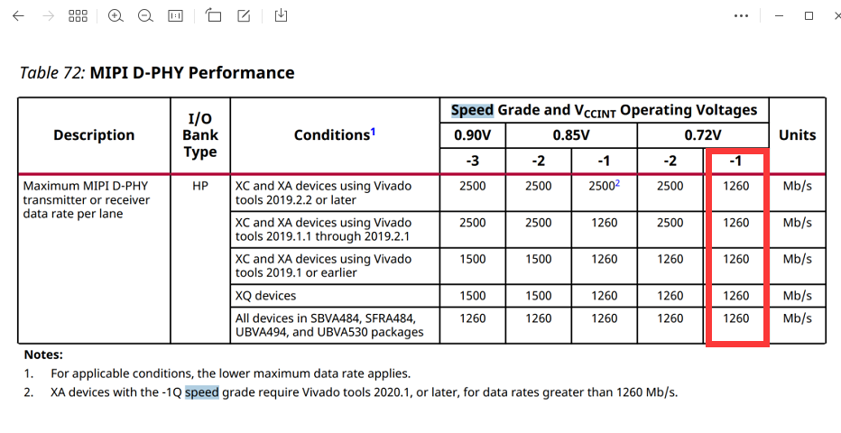

2022.11.4
在3EG板卡上通过max9295加串测试是否能达到4K传输
经测试，能达到1080p传输
但在4K测试中
根据数据手册

发现mipi Dphy的lane速率最大为1260Mbps
而4K所需的带宽
3840*1920*30*3*8/4=1493Mbps
故达不到需求

2023.5.16
测试it6801输入4k 30
通过手册改为DDR方式

2023.5.31
由于在625封装的3eg板上4K分辨率不对，故转换到2CG上
小板：793->792
测试4K rgb888,画面清晰良好

9295达不到rgb888，4k，30fps，对yuv422以及raw格式可达到，9296接收
96717达不到rgb888，4k，30fps，对yuv422以及raw格式可达到，717F固定在3Gbps，4k的raw也达不到，9296接收
96793可达到rgb888，4k，30fps，792接收

